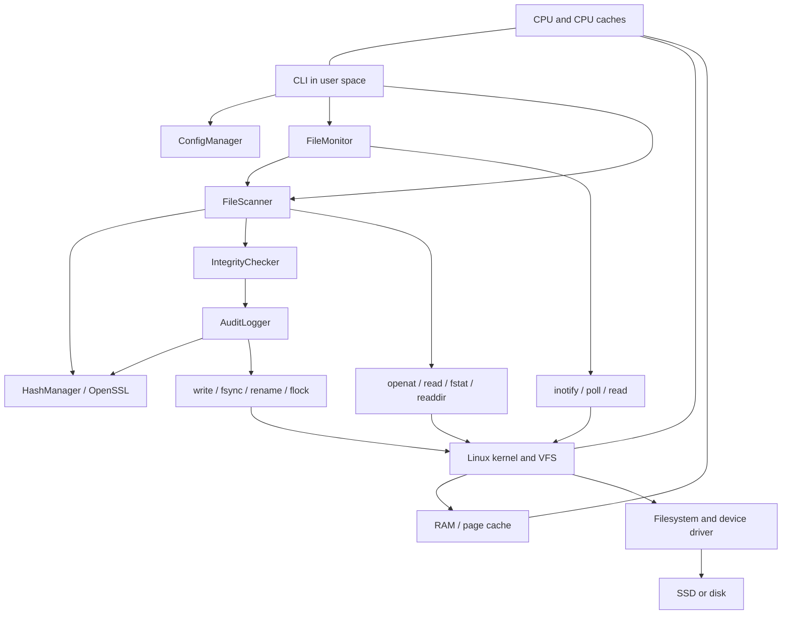

# Architecture and hardware/software interaction

`main.cpp` validates the CLI and coordinates the modules. `ConfigManager` handles baseline serialization, checksums, canonical paths, and advisory state locks. `FileScanner` walks directory descriptors and gathers hashes and metadata. `HashManager` streams bytes through OpenSSL's SHA-256 EVP interface. `IntegrityChecker` compares snapshots. `AuditLogger` verifies and appends a hash chain. `FileMonitor` manages inotify watches, batches events, and requests rescans.



Arrows between application modules describe data flow; `main.cpp` and `FileMonitor` orchestrate scanner, comparison, and logger calls.

## Connection to computer architecture

- **User and kernel mode:** C++ code, comparison logic, and OpenSSL hashing run in user mode. System calls enter kernel mode to access filesystem objects and event queues; the kernel returns results and errors to user space.
- **CPU:** SHA-256 transforms file blocks using integer and bitwise operations. The CPU also executes directory traversal, serialization, and comparison logic. OpenSSL may choose optimized routines for the host CPU.
- **RAM and caches:** File contents are read in 64 KiB buffers. The kernel page cache can satisfy reads without physical disk I/O. CPU caches hold frequently accessed code and data; map records and digest state reside in process memory.
- **Storage and I/O:** File descriptors identify kernel-managed open objects. `read` copies available bytes to the application. `fsync` requests persistence of state writes; atomic rename publishes a complete baseline file. Hardware and filesystem durability guarantees still apply.
- **Events and scheduling:** Filesystem changes cause the kernel to enqueue inotify events. `poll` blocks or times out while waiting for readiness; the scheduler resumes the process when work is available. An inotify event is a software notification, not a direct hardware interrupt delivered to the application. Device interrupts may participate in underlying storage I/O.
- **Concurrency:** `flock` serializes cooperating CLI processes. The scanner checks file identity, size, modes, modification time, and change time before and after hashing. These checks detect common concurrent writes but cannot turn an entire directory into an atomic snapshot.

## Data formats

`baseline.dat` starts with `FIA_BASELINE_V1`, followed by a hex encoded absolute root. Each subsequent file row contains tab-separated relative-path hex, SHA-256, decimal size, decimal permission bits, and signed modification time in nanoseconds. The final `CHECKSUM` row contains SHA-256 of all preceding bytes, including newlines. Rows are sorted by relative path.

`audit.log` starts with `FIA_LOG_V1`. Every record has ten tab-separated fields:

```text
sequence timestamp type path_hex old_hash new_hash detail_hex v1 previous_hash record_hash
```

The record hash is SHA-256 over the exact first nine fields, including tab separators, excluding the final tab, current hash, and newline. The initial previous hash is 64 zeroes. All text payload fields that may contain separators are encoded. Hash values are lowercase hexadecimal; `-` means unavailable or not applicable.

An `INIT` event binds the baseline bytes to the audit chain by storing their SHA-256 as its new hash. The baseline's self-checksum detects corruption; the log binding also detects a baseline rewrite with an updated self-checksum when the log remains trusted. Neither is a digital signature.

## Monitoring decisions

Inotify directory watches are not recursive, so the monitor adds one watch per existing subdirectory and refreshes watches after topology changes and during periodic reconciliation. Watch setup failures are surfaced. It observes close-after-write, creation, deletion, rename, and attribute notifications. Successful snapshots replace the last observed snapshot; unsuccessful snapshots retain it and emit `SCAN_ERROR`.

Matched rename cookies produce move events and relocate prior snapshot paths before comparison. A move over an existing file records the replaced file's hash in the event details. Cookie pairs separated across processed batches may instead be represented as deletion and creation. Snapshot comparison is the authoritative content check.

Pairs are processed in completion order, not numerical cookie order. Directory watch paths are remapped as soon as a directory pair is matched, so subsequent child notifications use the new prefix. Events whose parent directory is between an unmatched FROM and TO have uncertain paths and are left to snapshot reconciliation. Old hashes and replacement hashes use the snapshot adjusted by earlier moves. A final destination hash is omitted (`-`) if a later move affects that destination. Hashes are last-observed snapshot values, not claims about unsampled intermediate contents.

The monitor uses blocking `StateLock` acquisition for its initial state read and each append. Interrupted acquisition is retried, preserving the in-memory batch even if a stop signal arrives. Normal short commands and the separate single-monitor lock remain nonblocking. Genuine locking or I/O errors still propagate. While blocked, the monitor cannot consume inotify events, so queue overflow remains possible. Orderly shutdown finishes an already pending append and writes `MONITOR_STOP`, but does not drain all queued notifications or perform a final scan.

At command startup, `prepareState` rejects a directory not owned by the effective user or whose access mode is not `0700`. It applies private permissions to newly created state directories but never silently repairs existing ones. Parent-directory trust remains an operational requirement. See the [state-machine diagram](state-machine-diagram.md) for the existing CLI lifecycle.

## API references

- [Linux inotify manual](https://man7.org/linux/man-pages/man7/inotify.7.html): recursive watch requirements, rename cookies, event coalescing, and queue overflow.
- [OpenSSL EVP digest documentation](https://docs.openssl.org/3.0/man3/EVP_DigestInit/): digest initialization, streaming updates, and finalization.
