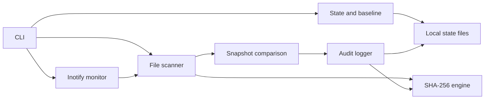
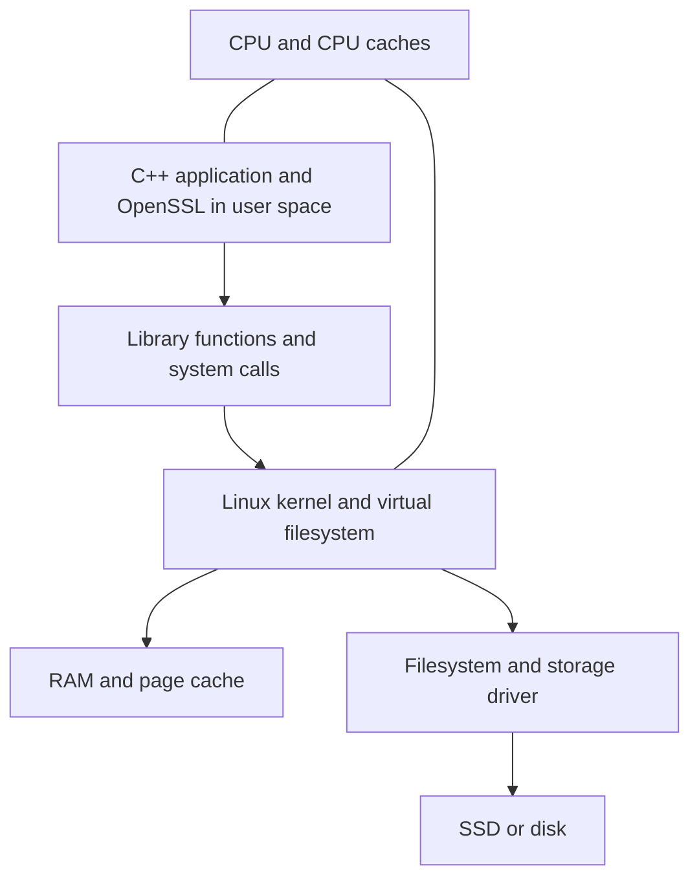

# File Integrity & Tamper-Evidence Audit System

Technical report and study draft based on the current implementation. Updated for the targeted audit fixes on 28 September 2026. The implementation was generated with AI assistance; this report does not claim independent student authorship. Final run evidence is recorded in [verification results](verification-results.md).

## 1. Title

**File Integrity & Tamper-Evidence Audit System** — a Linux C++17 command-line application for detecting regular-file changes and verifying an audit history.

## 2. Problem Statement

Files can change through mistakes, software updates, or unauthorized activity. Filenames and timestamps alone cannot establish whether content has changed. An ordinary editable log also provides weak evidence of its own consistency. This project compares current file hashes and metadata with a saved baseline and links audit records using SHA-256.

The tool detects differences; it does not determine whether a change was authorized or identify the person who made it.

## 3. Objectives

- Create a persistent baseline of regular files in a selected directory tree.
- Detect additions, deletions, content changes, permission changes, and modification-time changes.
- Monitor filesystem activity using Linux inotify and reconcile snapshots.
- Record events with timestamps and previous/current hashes.
- Verify the internal consistency of the audit chain and optionally compare its head with an external checkpoint.
- Demonstrate C++ resource management and Linux filesystem programming through a testable CLI.

## 4. Requirements

The build requires Linux, a C++17 compiler, CMake 3.16 or newer, and OpenSSL development libraries. Python 3 runs the integration tests. Ubuntu through WSL is supported; the executable is not a native Windows application. Test fixtures use the Linux filesystem under `/tmp`.

The process needs read/traversal access to protected files and write access to a separate state directory. State and protected directories must not contain each other. Ordinary operation does not require root. Memory and storage requirements depend on file count and log size; no measured minimum hardware specification is claimed.

State must be owned by the effective user with mode `0700`. Existing unsafe directories are rejected without automatic permission changes. Use a trusted Linux filesystem location and trusted parents; this validation is not a defense against privileged replacement of the filesystem hierarchy.

The commands are `init`, `scan`, `status`, `monitor`, `report`, `verify-log`, and `help`. See the [requirements mapping](requirements.md) and [README](../README.md).

## 5. System Architecture

Initialization saves the canonical root and baseline, then creates an `INIT` record that includes the hash of the baseline file. A scan verifies existing state, reads the current tree, compares snapshots, and appends differences plus a scan summary. Monitoring installs directory watches, compares an initial scan with the baseline, and thereafter compares successive successful snapshots.

## 6. Module Description

| Module | Responsibility |
| --- | --- |
| `main.cpp` | Validate commands/options, coordinate modules, print results, and return exit codes. |
| `ConfigManager` | Validate paths; save/load baseline files; provide encoding, atomic-write helpers, and state locking. |
| `FileScanner` | Walk directory descriptors, inspect regular files, hash contents, and check for changes during reads. |
| `HashManager` | Wrap OpenSSL SHA-256 for strings and streaming reads from file descriptors. |
| `IntegrityChecker` | Compare paths, hashes, sizes, permission modes, and modification times. |
| `AuditLogger` | Serialize events, calculate chain hashes, verify records, and synchronize appends. |
| `FileMonitor` | Manage recursive watches, batch notifications, associate rename pairs, rescan, and handle shutdown. |
| Shared types/helpers | Represent snapshots/events and release file descriptors through RAII. |

`baseline.dat` records relative paths, SHA-256 values, sizes, permission bits, and modification times. Its own checksum detects accidental corruption; the `INIT` binding also detects baseline replacement with a recomputed checksum when the audit log remains trusted.

## 7. UML Diagrams

The [class diagram](class-diagram.md) shows module dependencies and shared data. The [sequence diagrams](sequence-diagram.md) show scan and monitor execution. The [state-machine diagram](state-machine-diagram.md) describes the existing uninitialized, initialized, scanning, monitoring, error, and stopped lifecycle. These diagrams do not assume a GUI, database server, or network service.

## 8. Linux Concepts Used

The scanner uses directory and file descriptors, `openat`, `fstatat`, `fstat`, `read`, and `close`. `fdopendir` and `readdir` provide directory iteration through the C library. `O_NOFOLLOW` and descriptor-relative access reduce symlink traversal risks. File modes are inspected; the audit application does not change protected-file permissions.

The monitor uses `inotify_init1`, `inotify_add_watch`, `inotify_rm_watch`, and `poll`. Each directory needs a watch; matching rename cookies associate move notifications. Event overflow is reported, followed by reconciliation. These behaviors follow the [Linux inotify API](https://man7.org/linux/man-pages/man7/inotify.7.html).

`flock` serializes cooperating commands. `write`, `fsync`, and `rename` publish state. Signal handlers set a flag so the main loop can stop and log an orderly shutdown. Advisory locks do not stop a separate program that ignores the locking convention.

## 9. C++ Concepts Used

The implementation uses classes, structures, namespaces, constructors/destructors, exceptions, standard containers, filesystem paths, and C++17 structured bindings. Headers declare interfaces; source files implement them. `Snapshot` is a `std::map` keyed by relative path, which also gives deterministic path ordering.

RAII connects resource lifetime with object lifetime. `Fd` closes its descriptor on destruction. `std::unique_ptr` with custom deleters releases directory streams and OpenSSL contexts when normal returns or exceptions leave scope. Copying descriptor-owning objects is disabled to avoid duplicate ownership. The architecture uses composition; it does not require an inheritance hierarchy.

## 10. Computer Architecture Connection

The CPU executes traversal, comparison, serialization, and hash operations. File contents are processed in 64 KiB buffers rather than loading each whole file. Snapshot records and log parsing still consume memory proportional to their size. CPU caches hold frequently used instructions/data, while the kernel page cache may satisfy reads without physical storage access.

System calls cross from user execution into kernel services for filesystem access, event delivery, and synchronization. An inotify notification is a software event; it is not a hardware interrupt delivered directly to the C++ program.

## 11. Hardware/Software Interaction

Reading a file requests bytes through the kernel. The bytes may already be cached or may require storage I/O. Hashing processes the returned bytes in user space. Appending evidence writes data back through the kernel, followed by synchronization requests. Filesystem and hardware guarantees still determine durability under power loss.

## 12. Testing

CTest contains two test targets: the C++ unit executable and the Python integration suite. Unit checks cover known SHA-256 values, binary encoding, malformed encodings, and comparison categories. The 19 integration cases (9 original plus 10 regressions) exercise the real CLI in isolated temporary directories.

| Integration case | Verified behavior |
| --- | --- |
| Baseline corruption and binding | Reject corrupt data and a rewritten baseline with an updated checksum. |
| Empty tree | Initialize and scan zero regular files. |
| Log tampering and checkpoint | Reject edited/reordered/partial records; detect shortened history with a saved head. |
| Monitor duration | Stop after a requested duration. |
| Recursive monitoring and moves | Observe nested changes, file/directory renames, permission changes, deletion, and signal shutdown. |
| Scan and metadata | Classify content, size-related, permission, timestamp, added, and deleted differences. |
| Symlinks, special files, binary hashing | Exclude links/FIFOs and match Python hashlib on a multi-buffer binary file. |
| Unreadable file | Fail initialization without publishing a partial baseline. |
| Validation and locking | Reject invalid roots/options, reused state, a busy lock, and a missing log. |
| Rapid and ordinary renames (4 regressions) | Correct snapshot hashes, updated child paths, and continued recursive watching. |
| Monitor contention (2 regressions) | Wait without losing the prepared event batch, including SIGTERM while blocked. |
| Trusted state (4 regressions) | Reject unsafe modes and foreign ownership, accept valid private state, and recheck later commands. |

Builds and tests are verified in separate Linux filesystem build directories to avoid timestamp problems from Windows-mounted generated files. See [verification results](verification-results.md) for the current configurations, counts, and outcomes.

## 13. Results

The demonstration covers clean-file output, modifications/additions/deletions, discovery of a nested file while monitoring, its rename, and normal shutdown. The original September 27 verification passed the unit target and all 9 original integration cases, with a valid 13-record demo chain. The expanded post-fix verification is reported separately in [verification results](verification-results.md).

These results demonstrate the tested functionality. They do not establish completeness against every adversarial race, event storm, storage fault, or filesystem type. No throughput, latency guarantee, or production-scale benchmark is claimed.

## 14. Limitations

Every record contains the previous record's hash. Editing an internal record breaks subsequent verification unless the chain is recomputed. Deleting a complete suffix leaves a valid prefix, so internal verification alone cannot prove that the missing suffix ever existed. An externally retained exact head detects that change; legitimate later appends also change that head.

An attacker who can rewrite the baseline and the entire local log can replace the local evidence. No digital signature, remote checkpoint service, or secret key is implemented. The baseline's initial contents must already be trusted.

Only regular-file contents, sizes, modes, and modification times are monitored. Ownership, directory metadata, ACLs, extended attributes, symlink contents, and special files are outside scope. A scan is not an atomic tree snapshot. Notifications can be coalesced or lost; a short-lived file can disappear between snapshots. Rename pairs processed in different batches can appear as new/deleted events.

Completed rename pairs use event order, adjusted snapshot hashes, and immediately updated directory watch paths. Hashes refer to sampled contents; intermediate new hashes are omitted when later moves affect the destination. Unpaired or uncertain paths are reconciled from snapshots rather than invented.

The monitor performs full-tree hashing during reconciliation, and every append verifies the accumulated log. This prioritizes clarity over large-scale performance. The monitor waits for cooperating state-lock holders and retains its pending batch, including when interrupted by a stop signal; short commands can still receive a busy error. Waiting may delay shutdown indefinitely if a lock holder never releases the lock, and the kernel event queue may overflow meanwhile. Shutdown completes a pending append and records `MONITOR_STOP` but does not drain all notifications or perform a final scan. Crash-damaged state requires inspection; automatic repair is not implemented.

## 15. Future Scope

Possible future work includes authenticated remote checkpoints, signed audit heads, measured performance improvements, broader metadata coverage, and more systematic tests for queue overflow and filesystem races. These are proposals, not implemented capabilities or requirements for this version.

## 16. Conclusion

The verified implementation demonstrates baseline-based integrity checks, Linux event monitoring, and internally verifiable audit records. Its strongest presentation is a reproducible demo paired with a precise explanation of its trust assumptions and limitations. The [study guide](study-guide.md) maps each part of that explanation to the actual source code.
