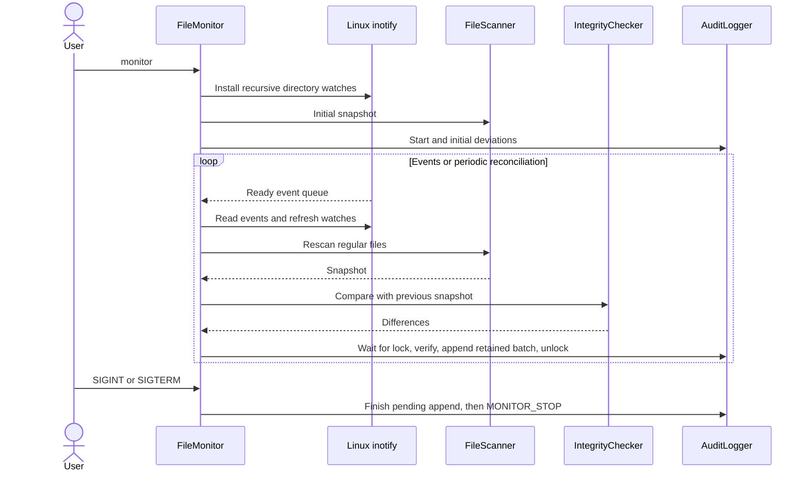

# Sequence diagrams

## Scan

```mermaid
sequenceDiagram
    actor User
    participant CLI
    participant Config as ConfigManager
    participant Scanner as FileScanner
    participant Checker as IntegrityChecker
    participant Log as AuditLogger
    User->>CLI: scan --state PATH
    CLI->>Config: Lock state and load baseline
    CLI->>Log: Verify chain and baseline binding
    CLI->>Scanner: Scan protected tree
    Scanner-->>CLI: Current snapshot or error
    CLI->>Checker: Compare baseline with snapshot
    Checker-->>CLI: Changes
    CLI->>Log: Append changes and scan summary
    Log-->>CLI: New chain head
    CLI-->>User: Events; exit 0 clean or 2 changed
```

## Monitor



The monitor retries interrupted state-lock acquisition. Stop requests may therefore wait for another command to release the lock. The diagram does not imply draining all remaining kernel events or performing a final scan. A fatal locking, verification, or I/O error exits with code 1 and may prevent the stop record.
