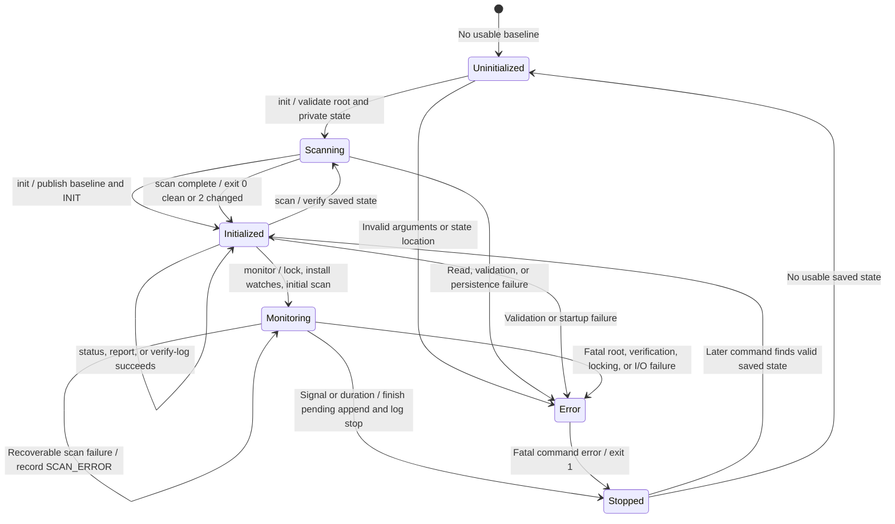

# State-machine diagram

These states describe existing CLI behavior and stored baseline availability. They are conceptual lifecycle states, not a new persisted state field or a background service.

`init` and `scan` use the same scanner but different completion actions. A changed scan exits with code 2; it is not an error state. Successful short commands exit while leaving persistent state initialized. `help` only prints usage and does not require initialized state.

The monitor's initial scan compares against the baseline. Later scans compare against the last successful snapshot. A recoverable scanning error is logged inside monitoring; fatal errors propagate to the CLI and exit with code 1. A failed initialization can leave incomplete files and requires inspection before using a new state directory.

Waiting for the state lock remains part of monitoring, not a new state. Pending event batches are kept until the lock is acquired, including after SIGTERM/SIGINT. An indefinitely held lock can therefore delay shutdown indefinitely. A normal stop does not perform a final scan or drain every queued event; `MONITOR_STOP` records process shutdown, not complete coverage through that instant.
